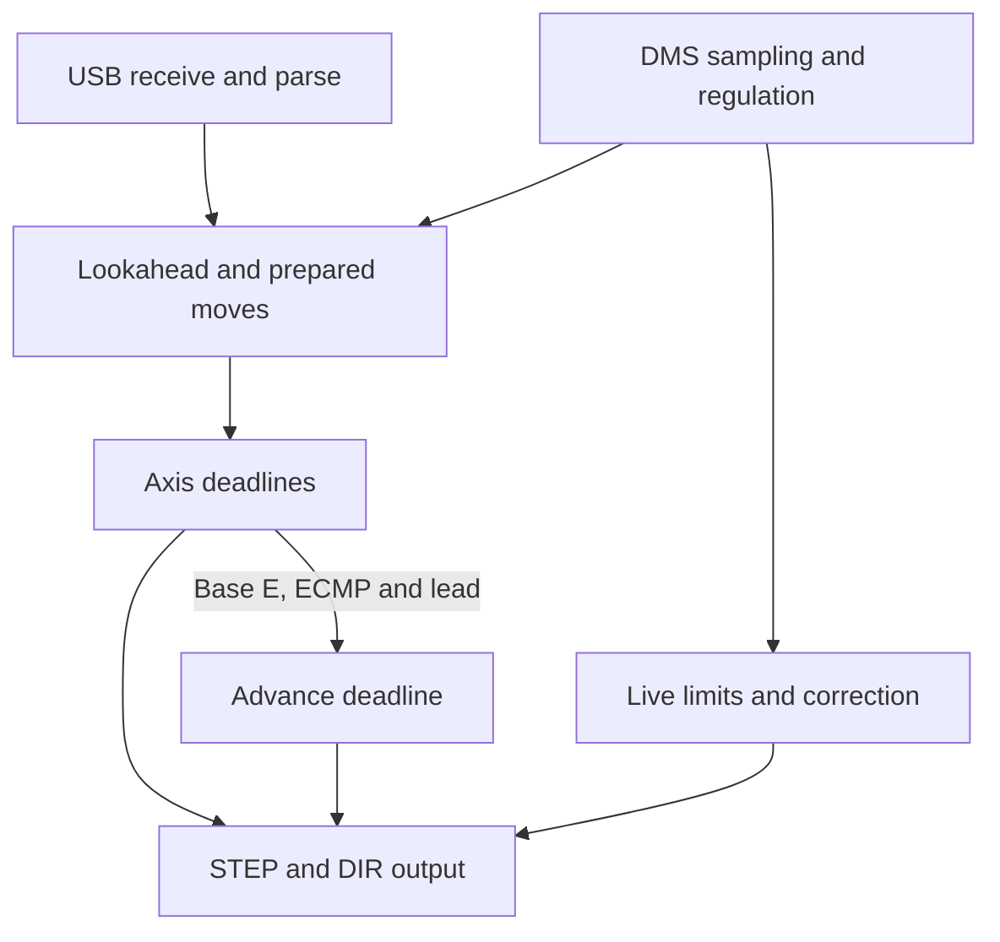

# Motion throughput and real-time timing

## Goal

Run RF1000, RF2000 and RF2000v2 at the highest sustainable print speed on the stock 16 MHz controller, including dense curves made of short G-code segments. Leave enough CPU time for UART reception and replies, lookahead, temperature control, DMS measurements, and responses to limits, pause and stop. Count delivered steps and check motion continuity and print quality at the same geometry, calibration and compensation settings.

The AVR timing baseline comes from [c0d2437](https://github.com/Nibbels/Repetier-Firmware/commit/c0d243745a71dcd603df2f33cf9a8d2b00fbda3a). The traces cover the three factory builds and the single-extruder RF2000 X44 retrofit. They count instructions in isolated paths. Interrupt latency under a full print and the margins at the driver pins still need hardware measurements.

## Who uses the CPU today

| Work | Execution and timing |
| --- | --- |
| USB input and replies | UART0 RX places bytes in a ring with 127 usable slots. The foreground parses one command per read call and feeds a two-command buffer and the 24-entry motion queue. The transmitter uses a 63-byte ring and waits for room when it fills. A full RX ring drops the incoming byte. The RX handler reads `UDR0` directly, so there is room to add separate diagnostics for hardware data overruns. [UART](../Repetier/UsbSerial.cpp#L100) · [Buffers](../Repetier/UsbSerial.h#L24) · [Parser](../Repetier/GCodeInput.cpp#L375) |
| Motion planning | The foreground converts each move to steps, computes its speed profile and updates lookahead. At fewer than ten queued entries, the current planner lengthens short moves whose requested time is below 250,000 ticks (15.625 ms at 16 MHz). Junction speed also depends on the length and angle of short segments. [Short-move rule](../Repetier/MotionPlanner.cpp#L63) · [Lookahead](../Repetier/MotionPlanner.cpp#L318) |
| XYZ and base E | Timer1 drives queued and direct moves and applies Z corrections. At the factory packing threshold of 3,300 ticks, a regular packed movement interval is at least 206.25 µs. Segment setup, completion and waits use their own intervals. Timer1 can extend a late short interval to the current count plus 100 ticks. [Timer1](../Repetier/HAL.cpp#L531) · [Packing](../Repetier/StepExecutor.cpp#L511) |
| Pressure Advance | Timer0 COMPA emits E steps when Advance is active. Timer1 feeds base E, ECMP and changes in extrusion lead to a signed pending count. A 15-count E interval at the factory E calibration is 60 µs. COMPA polls even when that count is empty. With Advance off it still enters at the same compare value once per Timer0 wrap, about every 1.024 ms. [E calibration](../Repetier/Extruder.cpp#L314) · [Advance ISR](../Repetier/HAL.cpp#L893) |
| Heaters and temperature inputs | Timer0 COMPB runs about every 256 µs. It drives heater and fan PWM, collects completed ADC conversions, starts the next conversion and signals periodic work. The foreground updates temperature control on the roughly 100 ms flag. Arduino uses Timer0 overflow for timekeeping. [PWM and ADC](../Repetier/HAL.cpp#L691) · [Foreground services](../Repetier/Commands.cpp#L41) |
| DMS, compensation and watchdog | The roughly 50 ms foreground service polls DMS over I²C and shares each scheduled reading among SenseOffset and the pressure limits. The configured 10 ms minimum interval for the DMS stop check is gated by that service. The watchdog interrupt requests Z recalculation at about 16 ms. External watchdog pings depend on recurring foreground progress. [DMS service](../Repetier/RF.cpp#L2965) · [Pressure intervals](../Repetier/Configuration.h#L261) · [Watchdog](../Repetier/HAL.cpp#L503) |

The AVR clears the global interrupt enable on entry. Timer1 masks its own compare interrupt and uses `sei` at selected points so other interrupts can run. Its own mask prevents Timer1 self-reentry in that path. Each pending timer flag is a bit, so repeated matches while service is blocked can coalesce. A burst can delay a falling edge, a UART read or a PWM update. After returning from an ISR, the processor runs an instruction in the interrupted context before serving another pending interrupt. Under sustained overload, the foreground can still receive too few instructions to feed the planner or service temperature and DMS on time. Count late service, hardware overrun, software ring overflow and watchdog resets separately. [AVR interrupt handling and USART receive errors](https://ww1.microchip.com/downloads/en/devicedoc/atmega640-1280-1281-2560-2561-datasheet-ds40002211a.pdf) · [Timer1 masking](../Repetier/HAL.cpp#L621)

At nominal 115,200 baud with 8N1, there are at most 11,520 incoming bytes per second and about 87 µs between consecutive bytes on a saturated line. With an empty software ring and timely RX interrupts, it takes about 11 ms of such input to fill the ring if the foreground stops consuming it. The hardware receive buffer has two levels plus the shift register. A long interrupt blackout can lose bytes much sooner, even with plenty of room in the software ring. [UART setup](../Repetier/UsbSerial.cpp#L48) · [ATmega2560 USART](https://ww1.microchip.com/downloads/en/devicedoc/atmega640-1280-1281-2560-2561-datasheet-ds40002211a.pdf)

### Why curves can hit the limit first

At 100 mm/s and 0.2 mm per chord, a curve needs 500 `G1` moves per second. With 40 transmitted bytes per line, including line framing, that is 20,000 bytes/s. At 115,200 baud the theoretical inbound ceiling in this example is 288 lines/s, or 57.6 mm/s on that path, before host flow control, retransmissions or parsing. A queue full of 24 such moves represents about 48 ms of planned motion at the requested speed. A long line can reach the step-output limit with much less serial and lookahead work. Compare sustained commands per second, buffered motion time and steps per second together.

The linked stock and retrofit AVR builds allocate 2,861 bytes to `PrintLine::queue` including metadata. They leave 1,418–1,691 bytes of SRAM beyond globals for stack and other runtime use. A deeper queue absorbs brief interruptions in the stream. Sustained throughput depends on the slowest stage. Identify that stage before changing the queue size. Compare supported binary G-code or shorter ASCII lines, host send-window use, and slicer chord tolerance at the same geometry error. Benchmark other baud rates through the USB bridge and host before selecting them. [Current queue](../Repetier/motion.h#L311) · [Serial protocol](../Repetier/GCodeInput.cpp)

## Lookahead, short moves and extrusion transitions

The planner sees the moves in the queue and the new move being prepared. It skips the queue front and reserves another 45,000 ticks (about 2.8 ms at 16 MHz) of estimated motion where available. Fixed joins can narrow the window further. The newest move starts with a conservative exit from `safeSpeed()` and the feedrate limit. A compatible successor can raise that exit while the join is still open to planning. Once a move starts executing, its entry and exit speeds are fixed. [Exit initialization](../Repetier/MotionPlanner.cpp#L161) · [Lookahead window](../Repetier/MotionPlanner.cpp#L318) · [Execution handoff](../Repetier/StepExecutor.cpp#L137)

| Rule | Current planner behavior |
| --- | --- |
| Low queue occupancy | `prepareMove()` extends the requested duration of a move below 15.625 ms if the queue contains fewer than ten entries. It changes the target speed when that move is planned. For a nominal 2 ms move, the queue term gives about 6.1 ms at nine entries and 2 ms at ten, before the other limits. Crossing the threshold between consecutive admissions can therefore create uneven planned speed even when the queue keeps moving. [Queue limiter](../Repetier/MotionPlanner.cpp#L63) |
| Short-segment geometry | `limitJunction()` weights the angular term by `(0.6 mm / previous distance)²` below 0.6 mm. It also applies separate Z and E velocity-change limits. This rule can affect a join with a well-filled queue. [Junction calculation](../Repetier/MotionPlanner.cpp#L213) |
| E-only boundary | When exactly one of the two moves is E-only and the join is still open, `updateLookahead()` fixes the previous exit and next entry at their existing values and skips the normal junction calculation. This covers an E-only retract or unretract next to an XYZ move, with Advance on or off. Two consecutive E-only moves use the ordinary junction path when eligible. [E-only check](../Repetier/MotionPlanner.cpp#L356) |
| Extrusion starts or ends during XYZ motion | With Advance active, a change in whether the adjacent XYZ moves have planned E steps also fixes the speeds and skips the normal join. This covers print to travel and travel to print, even when the XY path is straight. The intent is to give E pressure time to fall or build. The retained exit and entry can be above zero. With Advance off, the normal junction path can still constrain the change in E speed. [Advance check and rationale](../Repetier/MotionPlanner.cpp#L356) · [Planned E flags](../Repetier/motion.h#L236) |

A sustainable speed plan needs a reachable exit at the visible queue tail. Evaluate pacing from the amount of motion time actually buffered and the measured refill rate. Future segment lengths are unknown until their commands arrive. Compare a gradual limit and recovery with the present per-move queue rule. On identical geometry, replay both a steady stream and timed USB bursts so planned speed changes, actual starvation and executor delays can be distinguished.

Keep the current extrusion joins as a baseline for structural refactors. Review their print effect separately with continuous extrusion, print–travel–print, E-only retract and unretract, and short print segments whose E quantizes to zero. Repeat with Advance on and off. Record junction reason, entry and exit speeds, signed E pulses, pending E steps, requested lead and DMS response. Use the replay and physical prints to decide where a clean pressure transition benefits from a slow exit and where it produces an audible or visible hesitation. [Deferred review](maintenance-tasks.md#motion-smoothness-and-performance)

## Planner and executor boundary

`MotionPlanner` computes per-move limits, lookahead and step profiles in the foreground. A `PrintLine` keeps the lookahead data and prepared ramp in separate fields of the same 119-byte slot. A queued move stays blocked while lookahead updates its profile. Timer1 starts an available move with the prepared step rates and ramp lengths. The host replay matches the existing step intervals for short moves and extrusion joins, including a wrapped queue. [Planner](../Repetier/MotionPlanner.cpp) · [Step profile and queue](../Repetier/motion.h) · [Replay](../tests/pause-sense-offset.py)

A direct move reserves its slot and records the signed offset request in a short protected section. The foreground prepares its profile and publishes it under the timer lock. While preparation is in progress, Timer1 waits for publication. A jog release during preparation or before Timer1 starts the move fits the ramp to the 32-step tail. A release during execution shortens the remaining travel with the running ramp. [Direct request](../Repetier/Printer.cpp#L354) · [Prepare and publish](../Repetier/motion.cpp#L185) · [Timer entry](../Repetier/StepExecutor.cpp#L287)

After the executor and USB refactors, the four AVR builds use 47 fewer bytes of global SRAM and 952–976 fewer bytes of flash than [dfd0880](https://github.com/Nibbels/Repetier-Firmware/commit/dfd0880). The isolated step intervals, pulse traces and USART interrupt cycles match the reference cases. Full sampled `performMove()` calls cost 5–6 extra cycles in most cases and up to 25 extra cycles in the RF1000 direct path. Tests cover completion during a scan and ordinary completion. Measure elapsed service time under print load on the board.

## STEP and direction ownership

The DRV8711 advances on rising STEP edges. It specifies at least 1.9 µs high and 1.9 µs low, with 200 ns command setup and hold about the rising edge. If one handler raises STEP and another raises the same pin before the first fall, both handlers may book a step while the driver receives just one rising edge. A direction change near the edge can also violate the driver timing. The output owner for each motor owns both STEP edges and its direction. Select the owner and tool before the rising edge and complete the pulse with that selection. Target at least 2 µs per phase and verify it at the pins. In Timer1, the existing axis and position work already fills much of the high phase. Use that work to meet the minimum and group writes for different axes where the port map and pulse order allow it. Preserve unrelated bits on shared ports. [DRV8711 indexer timing](https://www.ti.com/lit/ds/symlink/drv8711.pdf#page=9) · [Pin map](../Repetier/pins.h)

| Condition | Current behavior and what to verify |
| --- | --- |
| Advance off | Timer1 raises and clears E. COMPA returns early. Other allowed ISRs can stretch the pulse between the two edges. |
| Advance on | Timer1 queues base and ECMP steps and updates the lead. COMPA selects E0 or E1 before emitting both edges. Its 32-cycle high interval is 2 µs at 16 MHz. Each steady mode assigns E output to one handler. |
| Mode change, tool change, pause and stop | A motion-queue wait currently covers Timer1 moves and Z correction. Pending E and pressure lead need their own completion check. Tool selection can change the active tool and direction context while there is pending work. Define how to finish, relax or cancel the old tool's pending steps at each transition, including an isolated step held by the direction filter. Publish tool, direction and interval consistently. |
| Pressure inhibit | Timer1 checks the pressure flag before accepting base and ECMP steps. COMPA consumes existing pending steps independently, and lead updates can change the count. In an RF2000 instruction trace, with the inhibit set and three positive steps pending in the current direction, COMPA emits a pulse on the selected tool and leaves two pending. Define and replay how the inhibit affects queued and newly requested E work before changing the scheduler. |

Verify nominal, suppressed and emitted step counts, including the DMS gate and endstop effects, at every handoff. Test that one physical rising edge accounts for one emitted step. [Timer1 E branch](../Repetier/StepExecutor.cpp#L378) · [Timer0 E branch](../Repetier/HAL.cpp#L893) · [Motion wait](../Repetier/Commands.cpp#L79) · [Tool selection](../Repetier/Extruder.cpp#L277) · [Lead update](../Repetier/StepExecutor.cpp#L80)

## Design and implementation order

The target is a short step executor with prepared motion from the foreground, an independent E deadline and one STEP/DIR output owner per motor.

1. **Establish the timing baseline.** Replay pulse accounting on short and long lines, travel, tight curves and packed XYZ/E moves. Record when work becomes due, starts and finishes. Measure queue coverage in milliseconds, UART service latency and foreground service gaps under the same input stream. Use on-board traces for concurrent execution and linked AVR instruction traces for individual paths.
2. **Finish the motion handoff.** Queued and direct moves now start with prepared profiles. Give each motor's pulse output one owner across queued, direct and scan moves. Fix and replay E mode and tool handoffs, the pressure inhibit and cancellation. Reuse `XYMotion`, `ZMotion` and the separate E accounts for nominal progress, compensation and motor steps.
3. **Arm COMPA on demand.** Preserve the independent E deadline and the 2 µs high pulse. Mask COMPA when it has no executable work. Wake it on a base step, a changed lead, pressure release or a direction-filter transition that makes a step executable. Include debug E requests and mode or tool changes in the audit. Arm a new future compare from `TCNT0` on wake and clear only the stale COMPA flag. Keep COMPB and the overflow interrupt running. Preserve the E interval and direction delay across counter wrap. Timer1 guards short deadlines with a future minimum. COMPA currently advances its previous compare value, so a late write can miss the intended match. For example, writing compare 115 after the 8-bit counter reached 117 schedules the match 254 ticks later, about 1.016 ms away. Track such late deadlines and test recovery without a catch-up burst. [Timer0 flags](https://ww1.microchip.com/downloads/en/devicedoc/atmega640-1280-1281-2560-2561-datasheet-ds40002211a.pdf) · [Compare updates](../Repetier/HAL.cpp#L893)
4. **Reduce work per delivered move.** Shorten the critical sections at the segment exchange. Prepare bounded integer step intervals and axis state in the foreground where the work fits the joint CPU budget. Keep the timer to due-step checks, limits, pulse output, counters and its next deadline. Continue publishing DMS compensation from the foreground. Use the curve replay to distinguish host delivery, parsing, junction calculation and queue starvation before tuning any of them. Keep prepared data compact and leave room for nested ISR stack use.
5. **Tune packing and pacing against measured reserve.** Simultaneous steps across different axes can share a pulse group. Repeated steps on one axis need distinct edges and minimum spacing. Packing amortizes timer entry and interval calculations across steps. Larger packs can concentrate both CPU work and physical pulses in a short burst. Bound ISR duration, the longest interrupt-disabled window and sustained interrupt load. Compare time-stamped pulses and axis phase error, then adjust packing or segment pacing to leave service time for UART, ADC, DMS and the foreground. Test the currently unused 64-tick Advance allowance and the 512-tick base-interval floor separately. The floor applies before the live Digit Flow scale. [Packing code](../Repetier/StepExecutor.cpp#L511) · [Fork experiment](https://github.com/afriess/RFx000x-Firmware/commit/0e11752)
6. **Compare timer architectures after those measurements.** A shared scheduler would dispatch the earliest due axis group or E event, including E before the first and after the last XYZ step. At a 206 µs packed Timer1 interval, several 60 µs E deadlines can fall between two Timer1 calls. Limiting E output to a queued XYZ move would also change pressure build-up and release. Prototype a shared scheduler if shortening the step path and eliminating COMPA polling leave measurable overhead to eliminate. Compare interrupt entry costs, deadline jitter, late-event recovery and pending E accounting.

The first quantified opportunity is COMPA polling. At 60 µs, the AVR trace takes 71 cycles per empty call on a single-extruder build and 79 on a dual build. This accounts for about 7.4–8.2% of CPU cycles while Advance is active and E is empty. With Advance off, 59–67 cycles every 1.024 ms account for about 0.36–0.41%. Continuous E pulses use 119–140 cycles per call, about 12.4–14.6% at 60 µs. These estimates exclude hardware entry overhead, preemption and scheduling changes. Real savings depend on idle time and wake overhead. [Current AVR pulse traces](maintenance-tasks.md#extrusion-planning)

## Performance measurements and acceptance

| Exercise | What to record |
| --- | --- |
| Long straight and diagonal moves, then circles with progressively shorter chords at the same speed | Planned and achieved feed, requested and delivered steps/s, queue coverage, host delivery and lookahead time, duration and cause of each slowdown or gap. |
| Calibrated extrusion with Advance on and off, Z fade and ECMP, active Digit Flow and Z-correction backlog | Signed XYZ and E counts, pending and lead E at both boundaries, STEP high and low, DIR setup and hold, pulse deadline error across packing and compare wrap, nested ISR time. |
| Continuous UART RX and TX while heating and sampling DMS | Hardware overruns and ring drops, ACK and resend rate, ADC data age, PWM deadline lateness and gaps between heater updates, DMS sample and inhibit latency, maximum span with interrupts masked, ISR load and foreground headroom. |
| First/last move, pause/resume, abort, homing, tool change and an endstop during a packed batch | Correct pulse accounting for each tool, response to limits and stop, first-layer behavior, temperature and watchdog under load. Check stack high-water on each model. |

Capture timing with short counters and summarize them outside the ISR. Use a verified spare test pin for logic-analyzer measurements where available. Measure the observer's overhead and use the same instrumentation on both sides of a comparison. Report worst-case gaps as well as averages. A faster setting must keep pulse accounting correct and service delays within their timing budgets. Set practical headroom targets from the stock-board measurements with heaters, DMS and serial load active.

## Reference designs and clock limits

- Grbl prepares bounded execution segments in the foreground on AVR and the step interrupt consumes that buffer. This is a pattern for moving speed-profile calculations out of the RFx000 step ISR while retaining local G-code and compensation. [Grbl segment preparation](https://github.com/gnea/grbl/blob/master/grbl/stepper.c)
- Klipper schedules independent step events with compact `interval`, `count`, and `add` commands. Its host-side planning illustrates another division of work. RFx000 has local DMS control and a USB G-code workflow, so use those workloads when assessing the cost of a protocol or board change. [Klipper step scheduling](https://www.klipper3d.org/Code_Overview.html) · [Benchmark scope](https://www.klipper3d.org/Benchmarks.html)
- Microchip specifies up to 16 MHz for this ATmega2560 at 4.5–5.5 V. A hypothetical 20 MHz would provide 25% more CPU cycles per second and be outside that specification. A clock change would require checking UART and bootloader timing, cycle-based STEP and scheduler settings, timekeeping, PWM, ADC and I²C. The configured USB line rate would still constrain throughput independently. Use the supported 16 MHz board for the performance target. Revisit board capability if the measured software ceiling remains too low. [ATmega2560 operating range, Figure 31-4](https://ww1.microchip.com/downloads/en/devicedoc/atmega640-1280-1281-2560-2561-datasheet-ds40002211a.pdf)
