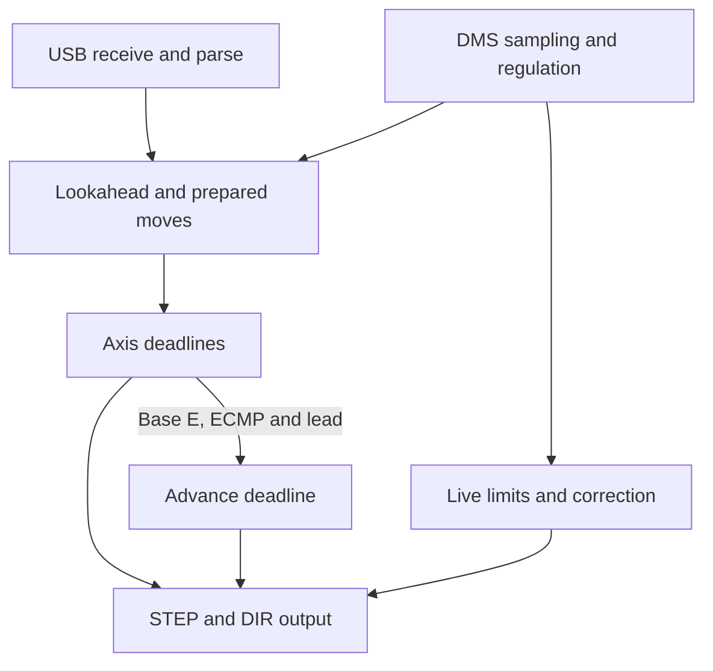

# Motion throughput and real-time timing

## Goal

Run RF1000, RF2000 and RF2000v2 at the highest sustainable print speed on the stock 16 MHz controller, including dense curves made of short G-code segments. Leave enough CPU time for UART reception and replies, lookahead, temperature control, DMS measurements, and responses to limits, pause and stop. Count delivered steps and check motion continuity and print quality at the same geometry, calibration and compensation settings.

The AVR timing baseline comes from [c0d2437](https://github.com/Nibbels/Repetier-Firmware/commit/c0d243745a71dcd603df2f33cf9a8d2b00fbda3a). The traces cover the three factory builds and the single-extruder RF2000 X44 retrofit. They count instructions in isolated paths. Interrupt latency under a full print and the margins at the driver pins still need hardware measurements.

## Who uses the CPU today

| Work | Execution and timing |
| --- | --- |
| USB input and replies | UART0 RX places bytes in a ring with 127 usable slots. The foreground parses one command per read call and feeds a two-command buffer and the 24-entry motion queue. The transmitter uses a 63-byte ring and waits for room when it fills. A full RX ring drops the incoming byte. The RX handler reads `UDR0` directly, so there is room to add separate diagnostics for hardware data overruns. [UART](../Repetier/UsbSerial.cpp#L100) · [Buffers](../Repetier/UsbSerial.h#L24) · [Parser](../Repetier/GCodeInput.cpp#L375) |
| Motion planning | The foreground converts each move to steps, computes its speed profile and updates lookahead. At fewer than ten queued entries, the current planner lengthens short moves whose requested time is below 250,000 ticks (15.625 ms at 16 MHz). Junction speed also depends on the length and angle of short segments. [Short-move rule](../Repetier/MotionPlanner.cpp#L63) · [Lookahead](../Repetier/MotionPlanner.cpp#L318) |
| XYZ and base E | Timer1 drives queued and direct moves and applies Z corrections. At the factory packing threshold of 3,300 ticks, a regular packed movement interval is at least 206.25 µs. Segment setup, completion and waits use their own intervals. Timer1 can extend a late short interval to the current count plus 100 ticks. [Timer1](../Repetier/HAL.cpp#L531) · [Packing](../Repetier/StepExecutor.cpp#L511) |
| Pressure Advance | Timer0 COMPA emits E steps when Advance is active. Timer1 feeds base E, ECMP and changes in extrusion lead to a signed pending count. Adding executable work arms Compare A, and the ISR masks it again after the last step. A 15-count E interval at the factory E calibration is 60 µs. [E calibration](../Repetier/Extruder.cpp) · [Advance ISR](../Repetier/HAL.cpp#L805) |
| Heaters and temperature inputs | Timer0 COMPB runs about every 256 µs. It drives heater and fan PWM, collects completed ADC conversions, starts the next conversion and signals periodic work. The foreground updates temperature control on the roughly 100 ms flag. Arduino uses Timer0 overflow for timekeeping. [PWM and ADC](../Repetier/HAL.cpp#L691) · [Foreground services](../Repetier/Commands.cpp#L41) |
| DMS, compensation and watchdog | The roughly 50 ms foreground service polls DMS over I²C and shares each scheduled reading among SenseOffset and the pressure limits. The configured 10 ms minimum interval for the DMS stop check is gated by that service. The watchdog interrupt requests Z recalculation at about 16 ms. External watchdog pings depend on recurring foreground progress. [DMS service](../Repetier/PressureFeatures.cpp) · [Pressure intervals](../Repetier/Configuration.h#L261) · [Watchdog](../Repetier/HAL.cpp#L503) |

The AVR clears the global interrupt enable on entry. Timer1 masks its own compare interrupt and uses `sei` at selected points so other interrupts can run. Its own mask prevents Timer1 self-reentry in that path. Each pending timer flag is a bit, so repeated matches while service is blocked can coalesce. A burst can delay a falling edge, a UART read or a PWM update. After returning from an ISR, the processor runs an instruction in the interrupted context before serving another pending interrupt. Under sustained overload, the foreground can still receive too few instructions to feed the planner or service temperature and DMS on time. Count late service, hardware overrun, software ring overflow and watchdog resets separately. [AVR interrupt handling and USART receive errors](https://ww1.microchip.com/downloads/en/devicedoc/atmega640-1280-1281-2560-2561-datasheet-ds40002211a.pdf) · [Timer1 masking](../Repetier/HAL.cpp#L621)

At nominal 115,200 baud with 8N1, there are at most 11,520 incoming bytes per second and about 87 µs between consecutive bytes on a saturated line. With an empty software ring and timely RX interrupts, it takes about 11 ms of such input to fill the ring if the foreground stops consuming it. The hardware receive buffer has two levels plus the shift register. A long interrupt blackout can lose bytes much sooner, even with plenty of room in the software ring. [UART setup](../Repetier/UsbSerial.cpp#L48) · [ATmega2560 USART](https://ww1.microchip.com/downloads/en/devicedoc/atmega640-1280-1281-2560-2561-datasheet-ds40002211a.pdf)

### Task0028 receiver service budget

The receive pump admits at most one complete command per call, as before, but now consumes at most 127 bytes (the usable RX ring capacity) before yielding. This also bounds the loop for comments, blank lines and binary resynchronization, which discard bytes without filling the 96-byte frame. The last-data timestamp is written once before consuming the first byte and the command slot is resolved only when a complete frame needs parsing. The standard serial replay checks continuity, acknowledgements and service visits across long discarded input. This is a byte-work bound, not an absolute wall-time guarantee: parsing, ACK/resend, TX backpressure, ISR preemption and other services still need end-to-end measurements. At nominal 115200 8N1 the empty ring fills in about 11 ms; separate USART hardware overrun (DOR0) and software ring overflow measurements remain for hardware validation. No baud, queue capacity, lookahead, pacing or emergency dispatch policy change.

### Why curves can hit the limit first

At 100 mm/s and 0.2 mm per chord, a curve needs 500 `G1` moves per second. With 40 transmitted bytes per line, including line framing, that is 20,000 bytes/s. At 115,200 baud the theoretical inbound ceiling in this example is 288 lines/s, or 57.6 mm/s on that path, before host flow control, retransmissions or parsing. A queue full of 24 such moves represents about 48 ms of planned motion at the requested speed. A long line can reach the step-output limit with much less serial and lookahead work. Compare sustained commands per second, buffered motion time and steps per second together.

The linked stock and retrofit AVR builds allocate 2,861 bytes to the 24-move queue and 175 bytes to the two decoded command slots, including metadata. Each additional planned move costs 119 bytes and each additional decoded command costs 86 bytes. The four builds leave 1,445–1,718 bytes of SRAM beyond globals for stack and other runtime use. Measure the stack high-water mark with nested interrupts and the print services active before sizing either queue. A deeper queue absorbs brief interruptions. Sustained throughput depends on UART, command admission and the work per move. [Motion queue](../Repetier/MoveQueue.h) · [Serial receiver](../Repetier/GCodeInput.cpp)

### Querying buffered motion

`PrintLine::queuedMoves().remainingMotion()` reports the XYZ path in millimetres, absolute filament travel and estimated movement time in seconds. Use `M3200 P14` to sample it over USB. The query takes a brief snapshot of the queue position and remaining primary steps, then reads the prepared geometry and ramps with interrupts enabled. It accounts for the unfinished part of the active move and skips warmup and queue tasks. The estimate uses the prepared entry, peak and exit rates, including the executor's minimum step interval. It measures scheduled motion time apart from pauses, blocked execution and live compensation. It uses the existing 119-byte slots.

## Lookahead, short moves and extrusion transitions

The planner sees the moves in the queue and the new move being prepared. It skips the queue front and reserves another 45,000 ticks (about 2.8 ms at 16 MHz) of estimated motion where available. Fixed joins can narrow the window further. The newest move starts with a conservative exit from `safeSpeed()` and the feedrate limit. A compatible successor can raise that exit while the join is still open to planning. Once a move starts executing, its entry and exit speeds are fixed. [Exit initialization](../Repetier/MotionPlanner.cpp#L161) · [Lookahead window](../Repetier/MotionPlanner.cpp#L318) · [Execution handoff](../Repetier/StepExecutor.cpp#L137)

| Rule | Current planner behavior |
| --- | --- |
| Low queue occupancy | `prepareMove()` extends the requested duration of a move below 15.625 ms if the queue contains fewer than ten entries. It changes the target speed when that move is planned. For a nominal 2 ms move, the queue term gives about 6.1 ms at nine entries and 2 ms at ten, before the other limits. Crossing the threshold between consecutive admissions can therefore create uneven planned speed even when the queue keeps moving. [Queue limiter](../Repetier/MotionPlanner.cpp#L63) |
| Short-segment geometry | `limitJunction()` weights the angular term by `(0.6 mm / previous distance)²` below 0.6 mm. It also applies separate Z and E velocity-change limits. This rule can affect a join with a well-filled queue. [Junction calculation](../Repetier/MotionPlanner.cpp#L213) |
| E-only boundary | When exactly one of the two moves is E-only and the join is still open, `updateLookahead()` fixes the previous exit and next entry at their existing values and skips the normal junction calculation. This covers an E-only retract or unretract next to an XYZ move, with Advance on or off. Two consecutive E-only moves use the ordinary junction path when eligible. [E-only check](../Repetier/MotionPlanner.cpp#L356) |
| Extrusion starts or ends during XYZ motion | With Advance active, a change in whether the adjacent XYZ moves have planned E steps also fixes the speeds and skips the normal join. This covers print to travel and travel to print, even when the XY path is straight. The intent is to give E pressure time to fall or build. The retained exit and entry can be above zero. With Advance off, the normal junction path can still constrain the change in E speed. [Advance check and rationale](../Repetier/MotionPlanner.cpp#L356) · [Planned E flags](../Repetier/motion.h#L236) |

A sustainable speed plan needs a reachable exit at the visible queue tail. `paceShortMove()` applies the admission policy before the existing per-axis limits and lookahead. A future time-based policy can use buffered motion and the observed refill rate to adjust the requested speed. Keep per-axis acceleration as a bound in the planner and test gradual recovery, starvation and CPU headroom under steady and bursty input.

Keep the current extrusion joins as a baseline for structural refactors. Review their print effect separately with continuous extrusion, print–travel–print, E-only retract and unretract, and short print segments whose E quantizes to zero. Repeat with Advance on and off. Record junction reason, entry and exit speeds, signed E pulses, pending E steps, requested lead and DMS response. Use the replay and physical prints to decide where a clean pressure transition benefits from a slow exit and where it produces an audible or visible hesitation. [Deferred review](maintenance-tasks.md#motion-smoothness-and-performance)

### Replay with steady and bursty input

The host replay baseline at [f21bfc5](https://github.com/Nibbels/Repetier-Firmware/commit/f21bfc52c877d446341667ce8df3c28f204acc7d) runs 300 extruding segments around a circle of radius 1.35 mm and requests 100 mm/s. For each chord length the three schedules use the same quantized XY and E moves and start with the same 12 prepared entries. That is 143.74 ms of planned motion at 0.20 mm and 156.48 ms at 0.60 mm before applying the ramps. Input averages 200 lines/s after prefill. In bursts the lines arrive at the modeled wire rate of 40 bytes per line with 8N1 framing at 115,200 baud. Lines wait at the source when the 24-move queue is full. [Reproduce with `python3 tests/pause-sense-offset.py`](../tests/pause-sense-offset.py)

| Chord | Offered input | Mean path speed | Segments stretched by low occupancy | Joins limited below both full speeds | Adjacent full-speed changes >20 mm/s¹ | Longest empty-queue gap |
| --- | --- | ---: | ---: | ---: | ---: | ---: |
| 0.20 mm | Steady | 39.71 mm/s | 68 / 300 | 155 | 10 | 0 ms |
| 0.20 mm | Groups of 32, 52 ms between groups | 39.80 mm/s | 54 / 300 | 161 | 12 | 0 ms |
| 0.20 mm | Groups of 96, 150 ms between groups | 41.16 mm/s | 28 / 300 | 182 | 4 | 45.43 ms |
| 0.60 mm | Steady | 75.14 mm/s | 10 / 300 | 289 | 0 | 0 ms |
| 0.60 mm | Groups of 32, 52 ms between groups | 75.14 mm/s | 10 / 300 | 289 | 0 | 0 ms |
| 0.60 mm | Groups of 96, 150 ms between groups | 75.14 mm/s | 10 / 300 | 289 | 0 | 0 ms |

¹ Counted after prefill using each segment's planned full speed. Mean path speed includes all motion, idle gaps and final queue drain. The longest modeled interval between Timer1 batches within a segment was 1.43–1.57 ms across the runs.

At 0.20 mm the ordinary bursts changed how often the low-queue rule engaged. Both the steady and 32-line runs kept moving even with adjacent setpoint changes above 20 mm/s. The longer interruption additionally caused one empty-queue gap. At 0.60 mm the tight turns constrained the computed join speeds and the modeled average was identical across the three schedules.

The replay uses the live planner, queue and step speed calculation with modeled arrivals and approximate batch timing. The model omits USB parsing and ACK time, planner CPU time, restart warmup, concurrent interrupts and compensation waits. Measure those contributions and STEP intervals on the printer when choosing a pacing policy.

A host-only trial stretched moves under 15.625 ms in proportion to the shortfall from a 60 ms reserve. It used the same 12 prepared starting moves. For 0.20 mm chords and 32-line bursts, adjacent full-speed changes over 20 mm/s rose from 12 to 25. In the 96-line run the empty-queue gap rose from 45.43 to 51.55 ms. A reserve measurement is useful for pacing, and the replay identifies the need to control speed recovery during refill.

## Planner and executor boundary

`MotionPlanner` computes per-move limits, lookahead and step profiles in the foreground. A `PrintLine` keeps the lookahead data and prepared ramp in separate fields of the same 119-byte slot. A queued move stays blocked while lookahead updates its profile. Timer1 starts an available move with the prepared step rates and ramp lengths. The host replay matches the existing step intervals for short moves and extrusion joins, including a wrapped queue. [Planner](../Repetier/MotionPlanner.cpp) · [Step profile and queue](../Repetier/motion.h) · [Replay](../tests/pause-sense-offset.py)

Each secondary axis receives the fraction of primary-axis acceleration given by its step count divided by the primary step count. The planner uses the configured print or travel acceleration in that ratio and rounds the primary allowance down. It derives lookahead and the step ramp from the same bound. In the 400:200 XY replay, a configured Y limit of 40,000 steps/s² previously projected to 40,019.5 steps/s² through the rounded intervals. The revised planner projects to 40,000 steps/s². Replay coverage includes extrusion and a long move whose exact calculation needs a 64-bit intermediate.

A direct move reserves its slot and records the signed offset request in a short protected section. The foreground prepares its profile and publishes it under the timer lock. While preparation is in progress, Timer1 waits for publication. A jog release during preparation or before Timer1 starts the move fits the ramp to the 32-step tail. A release during execution shortens the remaining travel with the running ramp. [Direct request](../Repetier/Printer.cpp#L354) · [Prepare and publish](../Repetier/motion.cpp#L185) · [Timer entry](../Repetier/StepExecutor.cpp#L287)

After the executor and USB refactors, the four AVR builds use 47 fewer bytes of global SRAM and 952–976 fewer bytes of flash than [dfd0880](https://github.com/Nibbels/Repetier-Firmware/commit/dfd0880). The isolated step intervals, pulse traces and USART interrupt cycles match the reference cases. Full sampled `performMove()` calls cost 5–6 extra cycles in most cases and up to 25 extra cycles in the RF1000 direct path. Tests cover completion during a scan and ordinary completion. Measure elapsed service time under print load on the board.

## STEP and direction ownership

The DRV8711 advances on rising STEP edges. It specifies at least 1.9 µs high and 1.9 µs low, with 200 ns command setup and hold about the rising edge. If one handler raises STEP and another raises the same pin before the first fall, both handlers may book a step while the driver receives just one rising edge. A direction change near the edge can also violate the driver timing. The output owner for each motor owns both STEP edges and its direction. Select the owner and tool before the rising edge and complete the pulse with that selection. The owner selects a 31-cycle (1.9375 µs nominal at 16 MHz) standard for the explicitly timed Advance HIGH phase; retain existing LOW-phase and DIR timing and verify all margins at the driver pins. In Timer1, the existing axis and position work already fills much of the high phase. Use that work to meet the minimum and group writes for different axes where the port map and pulse order allow it. Preserve unrelated bits on shared ports. [DRV8711 indexer timing](https://www.ti.com/lit/ds/symlink/drv8711.pdf#page=9) · [Pin map](../Repetier/pins.h)

| Condition | E step ownership |
| --- | --- |
| Advance off | Timer1 raises and clears E. Compare A is masked. Other allowed ISRs can stretch the pulse between the two edges. |
| Advance on | Timer1 queues base and ECMP steps and updates the lead. COMPA selects E0 or E1 before emitting both edges. Its 31-cycle high interval is 1.9375 µs at 16 MHz. Each steady mode assigns E output to one handler. |
| Tool or Advance setting change | Drain queued and direct moves and any Z wait. Release the old pressure lead and emit the remaining signed E balance on the existing tool. For the last step after a reversal, COMPA sets DIR and waits its usual compare delay before pulsing. Publish the tool or timer selection after the balance reaches zero. A serial change waits through a pause. A tool or Advance change from the panel requires a running queue state. |
| Motion completion | `M400` waits for pending E and pressure release before the next command executes. Immediate `M84` waits before disabling the motors. The `M3079` output sequence settles previous E work before its retract and waits for its own steps before disabling the motors. |
| Pause retract and return | Complete the frozen queue's E balance before starting the pause retract. The return distance counts steps admitted by Timer1 and subtracts those discarded before output. A subsequent Play retries only the undelivered part of a pressure-blocked return. |
| Pressure inhibit | A completed out-of-range DMS average discards pending E and pressure lead under the same interrupt lock that sets the inhibit. The gate applies to direct and queued base E, ECMP, new lead and `M223`. The next in-range average releases the pressure reason. Subsequent moves can produce fresh steps from the reached motor position. |
| Cancel or shutdown | A print cancel discards pending E before notifying the host. The stop gate stays set through timed cleanup and opens for the output script's own retract. Motor shutdown and emergency stop each have a separate reason. E setup can release the motor-disabled reason. Emergency stop holds its reason until reset. |

`ExtrusionOutput` owns the signed pending steps, requested lead, timer mode and inhibit reasons. The foreground can publish a mode or tool only at a settled boundary. Timer1 and the diagnostic command check the same inhibit before admitting new steps. COMPA can only consume the existing balance, which is zero throughout an inhibit. The previous branch could emit a pulse after DMS blocked E because COMPA still had pending work. [Output state](../Repetier/ExtrusionOutput.h) · [Timer1 E path](../Repetier/StepExecutor.cpp) · [COMPA](../Repetier/HAL.cpp) · [Motion wait](../Repetier/Commands.cpp)

Task0028 verifies the linked 31-cycle COMPA STEP-high pulse for each fitted extruder on all four variants (formerly 32 cycles). The replays cover signed steps in both directions, tool changes, Advance on and off, stop, and a pressure trip during both the pause retract and the return. They also cover lead release and the single step held before a reversal. Physical timing and service gaps under concurrent load remain open. [Host replay](../tests/pause-sense-offset.py)

### Owner decision: STEP HIGH cycle budget (2026-11-25)

At 16 MHz one CPU cycle is 62.5 ns. The DRV8711 specifies 1.9 µs minimum HIGH and LOW. The smallest nominal whole-cycle value meeting the HIGH specification is 31 cycles (1.9375 µs, 37.5 ns margin). Use this as the explicit Advance HIGH production standard; round upward in HAL::stepWithCount. Relative to the former 32 cycles, the saving is one CPU cycle per emitted Advance step (3.125% of that HIGH phase, about 0.104% total CPU at 16666.7 emitted steps/s). Timer1 performs useful accounting while STEP is high and is not shortened just to hit that value.

Below 31 cycles is reserved for separately authorized, instrumented optimization experiments, not production defaults. At 30 cycles the nominal 1.875 µs is 25 ns below the manufacturer's minimum. Internal design margin is unknown and cannot be assumed available across voltage, temperature, device lots and signal propagation. Later evaluate actual driver-pin HIGH/LOW and DIR timing, accepted step counts and tolerance across representative hardware with safe test conditions. A passing sample outside specification is not a guarantee. Physical verification remains a release gate; no below-minimum test or physical flash is part of Task0028.

## Design and implementation order

The target is a short step executor with prepared motion from the foreground, an independent E deadline and one STEP/DIR output owner per motor.

1. **Establish the timing baseline.** Replay pulse accounting on short and long lines, travel, tight curves and packed XYZ/E moves. Record when work becomes due, starts and finishes. Measure queue coverage in milliseconds, UART service latency and foreground service gaps under the same input stream. Use on-board traces for concurrent execution and linked AVR instruction traces for individual paths.
2. **Finish the motion handoff.** Queued and direct moves start with prepared profiles. `XYMotion`, `ZMotion` and the E planning and output owners account for nominal progress, correction and emitted steps. The AVR and host replays cover E mode and tool handoffs, pause, pressure inhibit and cancellation. [E handoffs](#step-and-direction-ownership)
3. **Use on-demand COMPA.** A base step, lead change, diagnostic request or drain can wake Compare A. The first deadline uses `TCNT0` plus one step interval. While pulsing, the ISR carries its cadence forward from the previous compare. A late compare restarts the interval from the current counter. The scheduler keeps at least two counter counts for normal compares and 40 after changing DIR. Only the Compare A flag and mask bit are written. COMPB and overflow continue running. [Timer0 flags](https://ww1.microchip.com/downloads/en/devicedoc/atmega640-1280-1281-2560-2561-datasheet-ds40002211a.pdf) · [Compare updates](../Repetier/HAL.cpp#L805)
4. **Reduce work per delivered move.** Shorten the critical sections at the segment exchange. Prepare bounded integer step intervals and axis state in the foreground where the work fits the joint CPU budget. Keep the timer to due-step checks, limits, pulse output, counters and its next deadline. Continue publishing DMS compensation from the foreground. Use the curve replay to distinguish host delivery, parsing, junction calculation and queue starvation before tuning any of them. Keep prepared data compact and leave room for nested ISR stack use.
5. **Tune packing and pacing against measured reserve.** Simultaneous steps across different axes can share a pulse group. Repeated steps on one axis need distinct edges and minimum spacing. Packing amortizes timer entry and interval calculations across steps. Larger packs can concentrate both CPU work and physical pulses in a short burst. Bound ISR duration, the longest interrupt-disabled window and sustained interrupt load. Compare time-stamped pulses and axis phase error, then adjust packing or segment pacing to leave service time for UART, ADC, DMS and the foreground. Test the currently unused 64-tick Advance allowance and the 512-tick base-interval floor separately. The floor applies before the live Digit Flow scale. [Packing code](../Repetier/StepExecutor.cpp#L511) · [Fork experiment](https://github.com/afriess/RFx000x-Firmware/commit/0e11752)
6. **Compare timer architectures after those measurements.** A shared scheduler would dispatch the earliest due axis group or E event, including E before the first and after the last XYZ step. At a 206 µs packed Timer1 interval, several 60 µs E deadlines can fall between two Timer1 calls. Limiting E output to a queued XYZ move would also change pressure build-up and release. Prototype a shared scheduler if shortening the step path and eliminating COMPA polling leave measurable overhead to eliminate. Compare interrupt entry costs, deadline jitter, late-event recovery and pending E accounting.

At a 60 µs interval, periodic COMPA in [6cd8384](https://github.com/Nibbels/Repetier-Firmware/commit/6cd8384c35ab7f9c74526ca0871d49cd76ea9ba8) spent 71–79 cycles per empty call, or about 7.4–8.2% of CPU cycles while Advance was active and E had no pending steps. This polling is gone. Linked AVR instruction traces show 132–153 cycles for a steady E pulse, up by 13 cycles, and 47 extra Timer1 cycles to wake COMPA. Adding a base E step while COMPA is armed costs five extra cycles in the sampled Timer1 paths. These counts omit hardware interrupt entry and preemption. The first deadline after waking typically allows up to 60 µs for Compare A to become due, plus IRQ latency. The sampled PWM and Arduino overflow handlers still take the same cycles with COMPA asleep. Global SRAM usage is identical across the four builds and flash grows by 148–180 bytes.

## Performance measurements and acceptance

| Exercise | What to record |
| --- | --- |
| Long straight and diagonal moves, then circles with progressively shorter chords at the same speed | Planned and achieved feed, requested and delivered steps/s, queue coverage, host delivery and lookahead time, duration and cause of each slowdown or gap. |
| Calibrated extrusion with Advance on and off, Z fade and ECMP, active Digit Flow and Z-correction backlog | Signed XYZ and E counts, pending and lead E at both boundaries, STEP high and low, DIR setup and hold, pulse deadline error across packing and compare wrap, nested ISR time. |
| Continuous UART RX and TX while heating and sampling DMS | Hardware overruns and ring drops, ACK and resend rate, ADC data age, PWM deadline lateness and gaps between heater updates, DMS sample and inhibit latency, maximum span with interrupts masked, ISR load and foreground headroom. |
| First/last move, pause/resume, abort, homing, tool change and an endstop during a packed batch | Correct pulse accounting for each tool, response to limits and stop, first-layer behavior, temperature and watchdog under load. Check stack high-water on each model. |

Capture timing with short counters and summarize them outside the ISR. Use a verified spare test pin for logic-analyzer measurements where available. Measure the observer's overhead and use the same instrumentation on both sides of a comparison. Report worst-case gaps as well as averages. A faster setting must keep pulse accounting correct and service delays within their timing budgets. Set practical headroom targets from the stock-board measurements with heaters, DMS and serial load active.

## Reference designs and clock limits

- Grbl prepares bounded execution segments in the foreground on AVR and the step interrupt consumes that buffer. This is a pattern for moving speed-profile calculations out of the RFx000 step ISR while retaining local G-code and compensation. [Grbl segment preparation](https://github.com/gnea/grbl/blob/master/grbl/stepper.c)
- Klipper schedules independent step events with compact `interval`, `count`, and `add` commands. Its host-side planning illustrates another division of work. RFx000 has local DMS control and a USB G-code workflow, so use those workloads when assessing the cost of a protocol or board change. [Klipper step scheduling](https://www.klipper3d.org/Code_Overview.html) · [Benchmark scope](https://www.klipper3d.org/Benchmarks.html)
- Microchip specifies up to 16 MHz for this ATmega2560 at 4.5–5.5 V. A hypothetical 20 MHz would provide 25% more CPU cycles per second and be outside that specification. A clock change would require checking UART and bootloader timing, cycle-based STEP and scheduler settings, timekeeping, PWM, ADC and I²C. The configured USB line rate would still constrain throughput independently. Use the supported 16 MHz board for the performance target. Revisit board capability if the measured software ceiling remains too low. [ATmega2560 operating range, Figure 31-4](https://ww1.microchip.com/downloads/en/devicedoc/atmega640-1280-1281-2560-2561-datasheet-ds40002211a.pdf)
